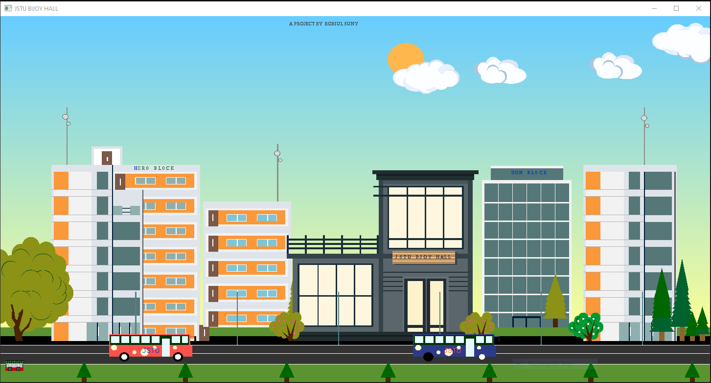

# JSTU BIJOY 24 HALL - OpenGL Animation

This project is a graphical animation created using OpenGL and GLUT (OpenGL Utility Toolkit) to simulate a moving bus along with animated clouds in a rural village scene. The animation is done using basic OpenGL primitives like circles, rectangles, and lines to represent various components such as the bus, windows, wheels, and clouds. It showcases the power of OpenGL for creating animations and simulations in C++.

## Features

- **Moving Bus:** The bus moves horizontally across the screen, with a set of windows and wheels that animate as the bus moves.
- **Clouds Animation:** The clouds move across the sky to simulate natural motion, enhancing the visual appeal.
- **Static Rural Scene:** Background elements like a rural environment can be adjusted for the desired look and feel.
- **OpenGL Primitives:** The entire animation is created using basic OpenGL primitives such as circles, quadrilaterals, and lines.

## Requirements

- **Operating System:** Any OS supporting OpenGL (Linux, macOS, or Windows)
- **Libraries:** 
  - **GLUT** (for OpenGL Utility Toolkit)
  - **OpenGL** (for rendering 2D graphics)
  - **GLU** (OpenGL Utility Library)

## Setup Instructions

1. **Install OpenGL and GLUT:**
   - **Linux:**
     ```bash
     sudo apt-get install freeglut3 freeglut3-dev
     sudo apt-get install libglu1-mesa-dev
     ```
   - **Windows:**
     - Download and install [GLUT](http://freeglut.sourceforge.net/) and set up OpenGL libraries in your IDE (Code::Blocks, Visual Studio, etc.)
   - **macOS:**
     OpenGL is already installed, but you might need to install GLUT via [Homebrew](https://brew.sh/):
     ```bash
     brew install freeglut
     ```

2. **Create a new C++ project:**
   - Use Code::Blocks or any IDE of your choice.
   - Include the necessary OpenGL and GLUT header files.
   - Make sure your project links the OpenGL and GLUT libraries.

3. **Compile and Run:**
   - Once the dependencies are set up, compile the project.
   - Run the executable to see the animation of the moving bus and clouds.

## Screenshots

Here is a screenshot of the bus animation:




## Code Overview

The main code includes several OpenGL functions to handle the following tasks:

- **Clouds Animation:**
  The clouds are created using circles with different colors to create the effect of moving clouds. The position of the clouds is updated continuously to simulate their movement across the screen.
  
- **Bus Animation:**
  The bus is drawn using a series of quadrilaterals and circles to represent the body of the bus and its wheels. The bus moves horizontally and is animated to simulate a moving vehicle.

- **Text Rendering:**
  The text "JSTU" is rendered on the bus using OpenGL's bitmap font rendering functions to display the name of the bus.

## Key Functions in the Code

- `myInit()`: Initializes the OpenGL environment, setting up background color, 2D projection, and enabling smooth shading.
- `display()`: The main rendering loop. This function updates the positions of the bus and clouds, and draws them frame by frame. It handles the animation of the bus, clouds, and drawing of the text "JSTU."
- `circle()`: A helper function to draw circles, used to create the wheels and clouds.

## How to Customize

You can easily adjust the speed of the moving bus and clouds, as well as the appearance of the bus, by changing the relevant parameters in the `display()` function. Additionally, you can customize the colors and shapes used for the bus, clouds, and other elements.

## Conclusion

This project demonstrates the basics of 2D graphics rendering using OpenGL, along with animation using GLUT. It is a good starting point for learning how to create interactive simulations with OpenGL. You can extend this project by adding more features like user interaction, more animated objects, or complex scene transitions.

## License

This project is licensed under the MIT License - see the [LICENSE](LICENSE) file for details.

## Acknowledgements

- OpenGL and GLUT for providing the tools to create this animation.
- The community forums and tutorials for helping understand the OpenGL and GLUT frameworks.

